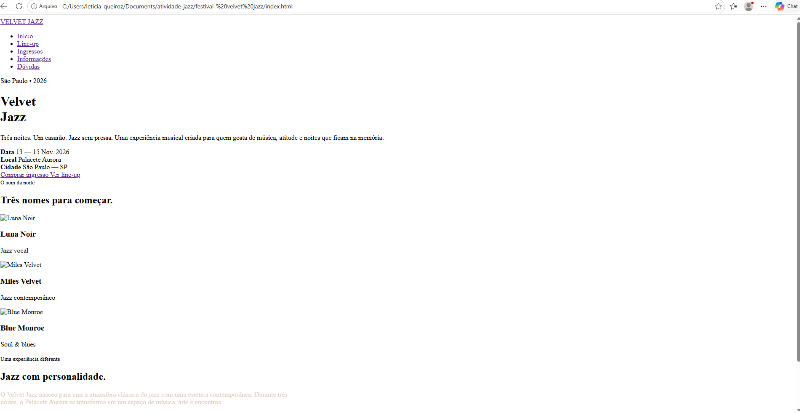
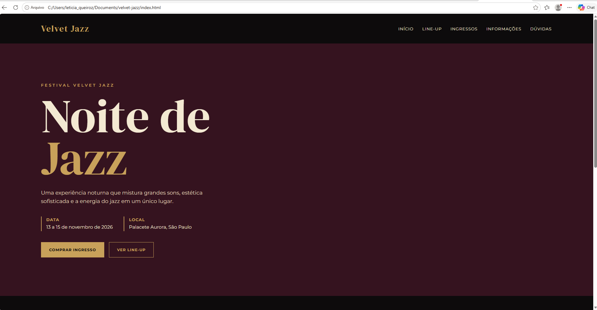

*Velvet Jazz*

*Aluna:* Letícia Queiroz dos Santos

*Site publicado:* https://velvet-jazz01.vercel.app/

*Briefing*

O Velvet Jazz é um festival de jazz fictício criado para o projeto, com uma proposta moderna, elegante e marcante. A ideia foi desenvolver um site que transmitisse a atmosfera de um evento noturno, sofisticado e ligado à música.

*Público:* adolescentes e jovens adultos que gostam de música, cultura, moda, fotografia e experiências diferentes.

Clima em 3 palavras: elegante, noturno e ousado.

*Paleta de cores:*

- #0D0B0C — Preto: usado principalmente nos fundos do site, trazendo um aspecto noturno e sofisticado.
- #35131F — Vinho escuro: usado em seções e fundos para reforçar a identidade visual.
- #641F35 — Vinho: usado em detalhes e contrastes, dando mais personalidade ao site.
- #C8A15A — Dourado: usado nos títulos, botões e detalhes para representar sofisticação.
- #F3E9D2 — Creme: usado nos textos e elementos claros para facilitar a leitura e criar contraste com os fundos escuros.

*Fontes:*

- DM Serif Display: utilizada nos títulos e no nome Velvet Jazz, trazendo uma aparência elegante e sofisticada.
- Montserrat: utilizada nos textos, menus e informações por ser uma fonte simples, moderna e fácil de ler.

*Sites de inspiração:*

- The Town: inspiração para a organização das informações e apresentação das atrações.
- Rock in Rio: referência para a estrutura de um site de festival, principalmente na divisão de line-up, ingressos e informações.
- Nublu: inspiração para a parte musical e para a atmosfera mais noturna e artística.

*Antes e depois*

()

 ()

*Os 4 prompts que mais fizeram diferença*

1. "Crie um conceito visual para um festival de jazz fictício com uma estética elegante, noturna, moderna e ousada."

2. "Crie uma paleta de cores para um festival de jazz com vinho, dourado, preto e creme, explicando a função de cada cor no site."

3. "Organize um site de festival de jazz em cinco páginas: início, line-up, ingressos, informações e dúvidas, com menu funcionando entre todas as páginas."

4. "Desenvolva o visual das cinco páginas do Velvet Jazz mantendo a mesma identidade visual, usando vinho, dourado, preto e creme. Organize os elementos de forma elegante e fácil de navegar, utilizando uma fonte sofisticada para os títulos e uma fonte simples para os textos. Crie também cards para os artistas e ingressos, botões de destaque, seções bem organizadas e um visual inspirado em jazz, com uma estética noturna e moderna."